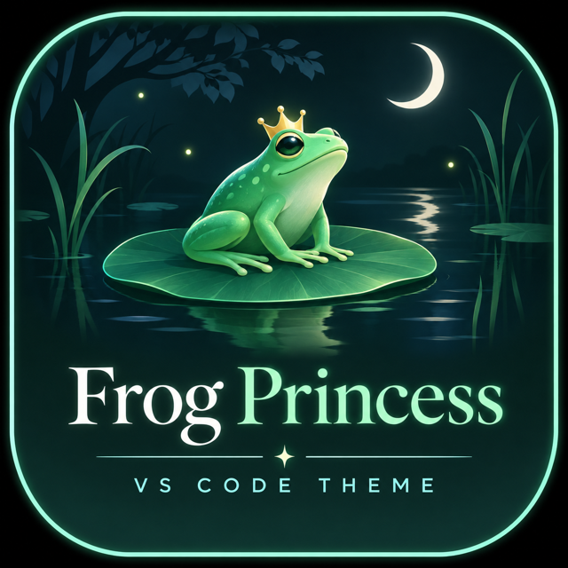
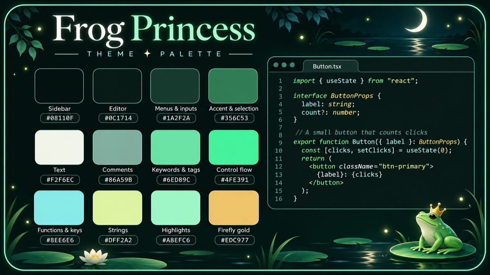

<p align="center"></p>

# Frog Princess

A dark VS Code theme with bayou-night greens, lily-pad jade, pale moss light and a glint of firefly gold.

## Palette



<!-- palette:start -->
| Role | Color |
| --- | --- |
| Sidebar and panels | `#08110f` |
| Editor background | `#0c1714` |
| Menus, inputs and widgets | `#1a2f2a` |
| UI accent (selection, buttons) | `#356c53` |
| Text | `#f2f6ec` |
| Comments | `#86a59b` |
| Keywords, operators, tags | `#6ed89c` |
| Control flow (italic) | `#4fe391` |
| Functions, keys, attributes | `#8ee6e6` |
| Strings | `#dff2a2` |
| Highlights and links | `#a8efc6` |
| Firefly gold: types, numbers, constants, this, regex, cursor | `#edc977` |
<!-- palette:end -->

## Install

Search for **Frog Princess** in the Extensions view, or run:

```
code --install-extension thaisemanuele.frog-princess
```
